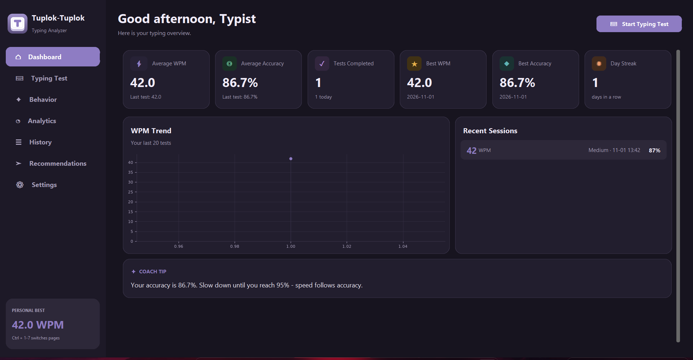
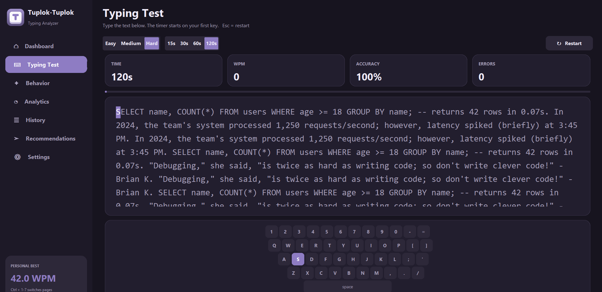
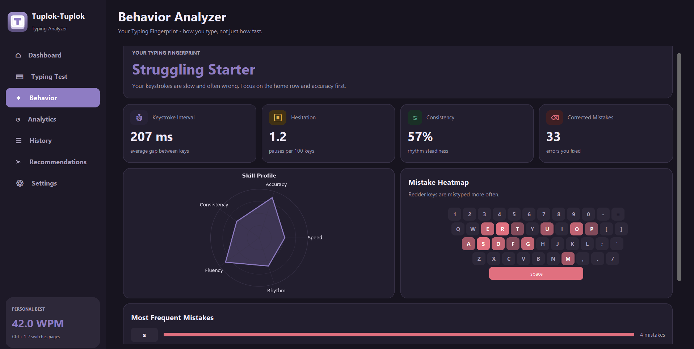
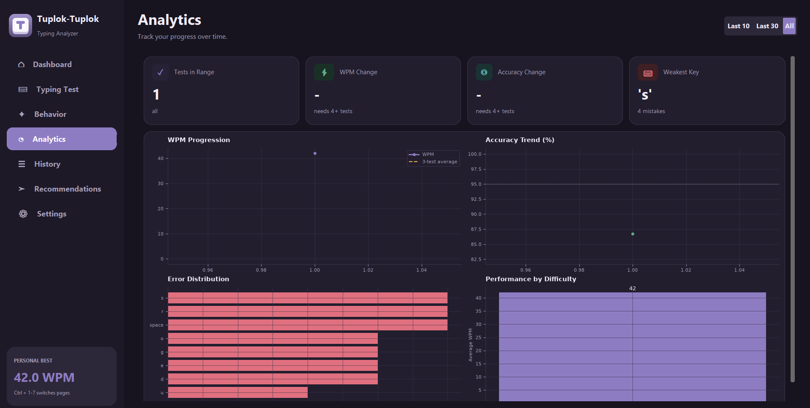
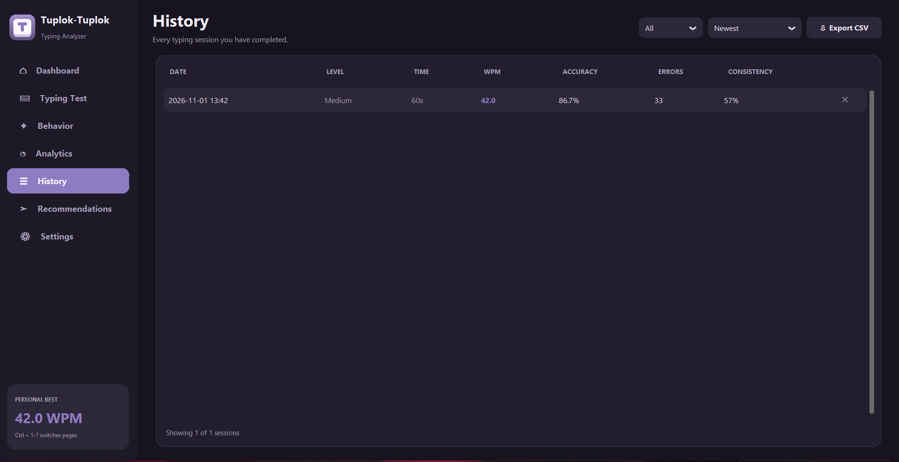
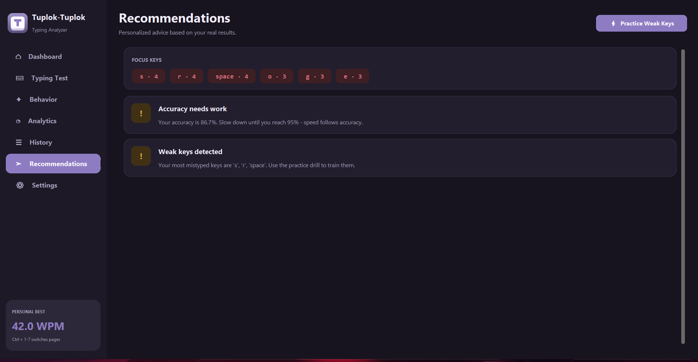
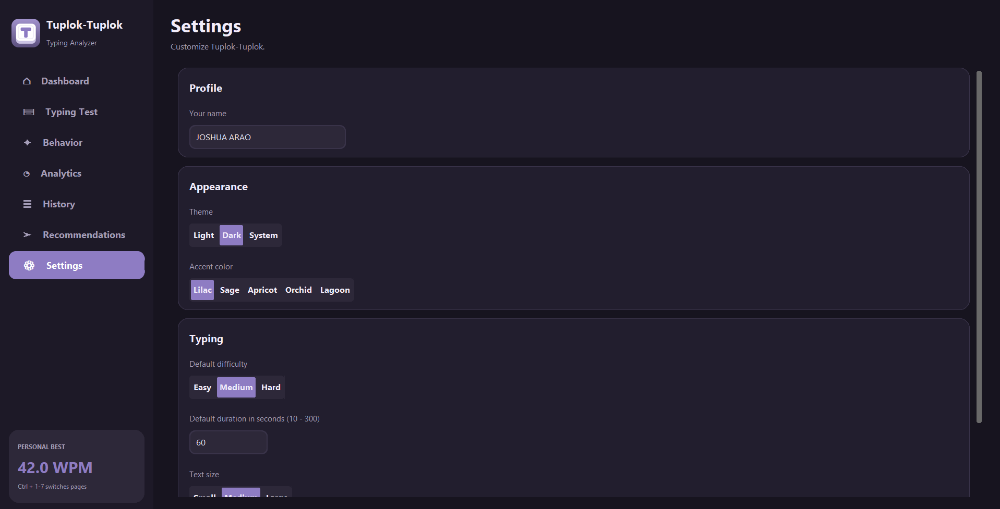

<div align="center">


# Tuplok-Tuplok

### Typing Behavior &amp; Accuracy Analyzer

*Don't just measure how fast you type. Discover **how** you type.*

<br>


</div>

---

## ✨ Overview

**Tuplok-Tuplok** is a desktop typing trainer that goes beyond words-per-minute. It records every keystroke, saves your sessions locally, and builds a **Typing Fingerprint**: a profile of your mistakes, rhythm, hesitation and consistency. It then turns that data into charts and personalized advice.

> *"Tuplok-tuplok"* is the sound of fingers tapping keys. 🎹









## 🧬 The Typing Fingerprint

The signature feature. After each test, the app analyzes **how** you typed, not only how fast.

| Signal | What it tells you |
|---|---|
| 🔴 **Most frequent mistakes** | Which keys you miss most, shown as a keyboard heatmap |
| ⏱ **Keystroke interval** | Your average gap between keys, in milliseconds |
| ⏸ **Hesitation pattern** | How often you pause for more than 1 second (per 100 keys) |
| ≋ **Typing consistency** | How steady your rhythm is, from 0 to 100% |
| ⌫ **Corrected mistakes** | How many wrong characters you caught and erased |
| 🕸 **Skill radar** | Speed, Accuracy, Consistency, Fluency and Rhythm on one chart |

From these signals you receive a typing style such as **Steady Sprinter**, **Careful Thinker**, **Burst Typer** or **Fast but Error-Prone**.

---

## 🚀 Features

| Module | Highlights |
|---|---|
| 🏠 **Dashboard** | Average WPM and accuracy, tests completed, personal records, day streak, WPM trend, recent sessions, coach tip |
| ⌨️ **Typing Test** | Random passages, 3 difficulty levels, adjustable timer, live character highlighting, on-screen keyboard, results screen with record detection |
| 🧬 **Behavior Analyzer** | Typing Fingerprint, skill radar, mistake heatmap, top mistyped keys |
| 📊 **Analytics** | WPM progression with moving average, accuracy trend, error distribution, performance by difficulty |
| 🕘 **History** | Every session with date, level, WPM, accuracy and errors; filter, sort, delete, export to CSV |
| 💡 **Recommendations** | Advice generated from your real results, plus a **Practice Weak Keys** drill built from your own mistakes |
| ⚙️ **Settings** | Light, dark or system theme, 5 accent colors, default difficulty and duration, text size, keyboard toggle |

---

## 🧮 How the numbers are calculated

| Metric | Formula |
|---|---|
| **WPM** | `(correct characters ÷ 5) ÷ minutes` |
| **Accuracy** | `(total keystrokes − wrong keystrokes) ÷ total keystrokes × 100` |
| **Error rate** | `wrong keystrokes ÷ total keystrokes × 100` |
| **Consistency** | `100 − 50 × (std. deviation ÷ mean of keystroke intervals)`, limited to 0–100 |
| **Hesitation** | gaps over 1 second, per 100 keystrokes |

A mistake still counts toward accuracy after you correct it, so accuracy reflects what you really typed.

---

## 🛠 Tech Stack

- **Python 3.9+**: application language
- **CustomTkinter**: modern, themed desktop interface
- **SQLite**: persistent local storage (`tuplok.db`, created automatically)
- **Matplotlib**: embedded analytics and radar charts
- **Pillow**: generates the app logo

---

## 📦 Installation

```bash
# 1. Clone the repository
git clone https://github.com/<your-username>/tuplok-tuplok.git
cd tuplok-tuplok

# 2. Install the dependencies
python -m pip install -r requirements.txt

# 3. Run the app
python main.py
```

> **Windows:** use `py` instead of `python` if the command is not found.
> **Linux:** if you see `No module named tkinter`, run `sudo apt install python3-tk`.

---

## ⌨️ Shortcuts

| Key | Action |
|---|---|
| `Ctrl` + `1` … `7` | Switch between pages |
| `Esc` | Restart the typing test |
| `Enter` | Start a new test after finishing one |
| `Backspace` | Correct a mistake (counted as a corrected mistake) |

---

## 🗂 Project Structure

```
tuplok-tuplok/
├── main.py          # entry point
├── ui.py            # main window and sidebar navigation
├── pages.py         # one class per page (Dashboard, Typing Test, Analytics, ...)
├── widgets.py       # reusable cards, charts, responsive layouts, on-screen keyboard
├── theme.py         # colors, fonts and the Pillow-drawn logo
├── logic.py         # WPM and accuracy math, Typing Fingerprint, recommendations
├── database.py      # all SQLite operations
├── assets/          # logo
└── requirements.txt
```

**Design principle:** the UI (`ui.py`, `pages.py`, `widgets.py`), the application logic (`logic.py`) and the data layer (`database.py`) are kept in separate modules.

---

## 🎨 Design

- Soft **light theme** with warm, uncommon colors, plus a matching plum dark theme
- Sidebar navigation, rounded cards and a layout that adapts to the window size
- Smooth typing: only the character you just typed is repainted

---

## 👤 Author

Built by **Joshua C. Arao** 

<div align="center">

<br>

*Type more. Notice more. Improve faster.* ✨

</div>
